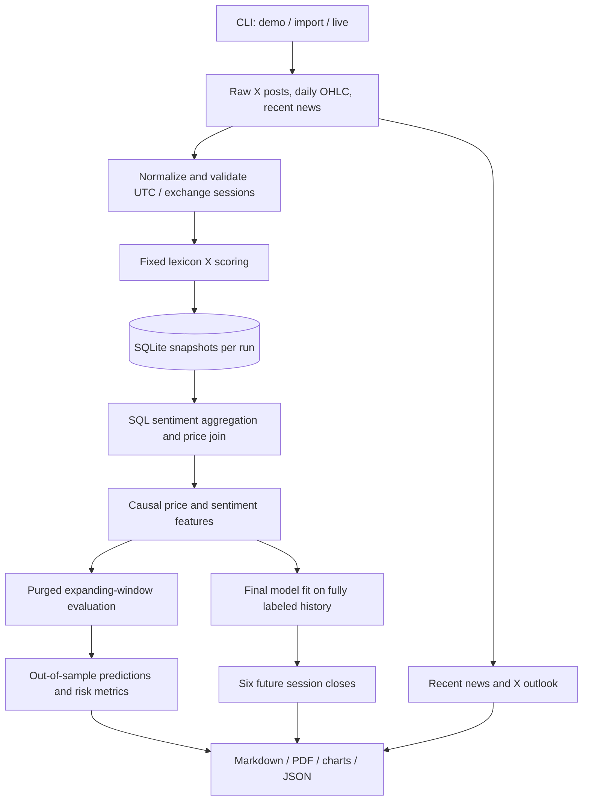

# Implemented architecture

The project has two entry points sharing sentiment utilities:

1. `src/agent.py` / `src/api/routes.py`: FastAPI text sentiment service.
2. `scripts/forecast.py`: the assessment's batch research pipeline.

## Forecast pipeline

| Module | Responsibility |
|---|---|
| `src/forecasting/providers.py` | Apify execution, polling, dataset pagination, weekly searches, Tavily |
| `data.py` | Parsing, normalization, price validation and exchange calendar |
| `storage.py` | Run-scoped SQLite tables, SQL aggregation/join and outputs |
| `features.py` | Causal feature whitelist and six future log-return targets |
| `model.py` | Ridge estimation, purged walk-forward folds, baselines and risk metrics |
| `pipeline.py` | Orchestration, frozen text scoring, manifests, artifacts |
| `reporting.py` | Sentiment/price chart, forecast matrix, equity, reports and one-page PDF |
| `demo.py` | Deterministic synthetic test data, explicitly marked |

At each bar close t, inputs contain price information through t and posts created
no later than t. After-close/weekend posts map to the next exchange close. The
model forecasts the next six closes. Historical engagement snapshots and current
news never enter those old feature rows. The strategy uses next-open execution.

The database retains each run independently: `forecast_runs`, `price_bars`,
`x_posts`, `asset_news`, `forecast_features`, `forecast_outputs`. Raw snapshots and
package/code/data hashes accompany every output directory. No worker queue,
automated scheduler, brokerage connection or trade execution is implemented.

## Text API

Application lifespan creates and closes one repository and analyzer. Routes obtain
these from app state. The analyzer combines rule scores and a TF-IDF/logistic
regression pipeline. Background tasks store results through a serialized SQLite
write path. This API has a separate database from the forecasting CLI by default.
